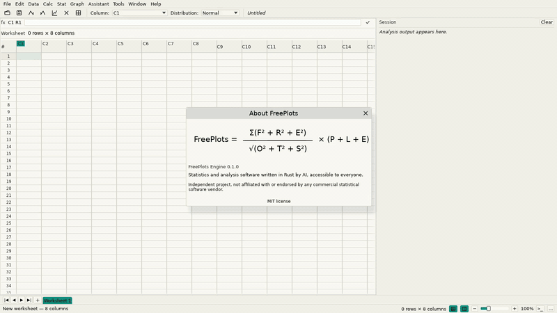

# FreePlots

**FreePlots is a classic statistics and analysis application built entirely by AI with a single commitment: to be open, free and accessible to everyone.**

Statistical desktop application in Rust: an editable worksheet, a Session report and the classic analyses (descriptive statistics, capability, control charts, MSA, hypothesis tests, ANOVA, regression, DOE, reliability).



## Why FreePlots

- **Free and open.** MIT licensed, no account, no subscription and no telemetry.
- **Offline by design.** Every analysis runs on your machine; the program never calls the network.
- **Portable.** One executable, no installer and no administrator rights.
- **Transparent.** Every report states the method, the sample size, the exclusions and the warnings.
- **Familiar.** A worksheet, a Session window, classic menus and graphs in their own windows, the way industrial statistics has always been done.

## What is inside

### Worksheet and Session
- Editable grid with `C1..Cn` columns; type, paste from a spreadsheet, insert/delete rows and columns, undo and redo.
- Multiple worksheets, per-sheet selection and undo, sortable columns and a formula bar.
- Import CSV (delimiter, decimal comma and header detection in a preview) and Excel `.xlsx`.
- Save CSV, Excel, `.fpp` projects and print-ready Session reports (PDF and HTML).
- The Session keeps every report, with English and Portuguese wording.

### Analyses
- **Descriptive statistics**: N, missing, mean, SE mean, StDev, quartiles, median, min/max, confidence intervals, grouped by any column.
- **Capability**: normal and non-normal (lognormal, Weibull, exponential, logistic, loglogistic, gamma, extreme value), Cp/Cpk/Pp/Ppk, expected and observed PPM, Box-Cox, stability gate.
- **Control charts**: I-MR, X-bar/R, X-bar/S, EWMA, CUSUM, P/NP/C/U and Laney charts, with the eight tests for special causes and per-test sensitivities.
- **MSA**: Gage R&R (crossed and nested), Gage Type 1, linearity, attribute agreement (kappa).
- **Hypothesis tests**: t tests, proportions, variances, equivalence (TOST), Mann-Whitney, Wilcoxon, Kruskal-Wallis, Friedman, Mood, sign test.
- **ANOVA**: one-way with Tukey, Bonferroni, Fisher LSD and Games-Howell; two-way with the interaction.
- **Regression**: OLS with numeric and categorical predictors, stepwise/forward/backward selection, binary logistic, ordinal logistic and Poisson.
- **DOE**: full and fractional factorials, Plackett-Burman, Taguchi arrays, response surface (CCD, Box-Behnken), steepest ascent and desirability.
- **Reliability**: Kaplan-Meier, Weibull, lognormal and exponential fits, accelerated life testing and step-stress.
- **Multivariate and time series**: PCA, k-means, T-squared, correlation matrices, decomposition, smoothing and forecasts.
- **Quality tools**: Pareto, histogram, boxplot, ECDF, dotplot, matrix plot, interval plot, run chart, stem-and-leaf and curve fit.

### Graphs
- Probability plots (Normal, Lognormal, Weibull, Exponential, Logistic, Loglogistic, Gamma, Extreme Value and 3-parameter families), histograms, capability plots, control charts, scatterplots, matrix plots and multi-panel plots.
- Graph text, annotations, reference lines, percentile lines, data labels, panel layout, axis ranges, gridlines and report blocks.
- Export to SVG, PNG, JPEG and a one-page PDF.

### Samples
The **Samples** button opens a gallery of ready worksheets with the analysis already run: Cpk, Weibull PPM, Gage R&R, 2^k screening, response surface, I-MR/X-bar/P charts, two and three probability panels, matrix plots, Pareto, regression, Kaplan-Meier and time-series decomposition. Every sample is a normal worksheet: change the data, rerun the analysis or use it as a template.

## Get started

### Portable builds
Portable executables are produced for **Windows x86_64** and **Linux aarch64**. There is no installer, no registry and no administrator requirement.

### Build from source
Rust 1.99 or newer:

```bash
cargo build --release -p fp-app --features desktop
./target/release/FreePlots
```

The desktop feature needs the usual X11/OpenGL development packages on Linux. The engine, the CLI and the headless UI layer build without them.

### Windows rendering

The Windows build uses **wgpu** (D3D12/Vulkan) by default. If a machine needs the OpenGL backend, start it with `FreePlots.exe --renderer glow`, or set `FREEPLOTS_RENDERER=glow`. Linux uses the OpenGL backend by default; `--renderer wgpu` is available there too.

CI starts the built executable on a Windows desktop and asks its automation bridge for a screenshot, so a renderer that opens a blank client area fails the build instead of reaching a user. The same check runs on a normal Windows machine:

```powershell
powershell -NoProfile -File scripts/windows-gui-smoke.ps1 -Exe target\release\FreePlots.exe
```

### First steps
1. Open a CSV (`File > Open CSV...`) or press **Samples** and pick an example.
2. Choose an analysis from the **Stat** menu.
3. Read the report in the Session and the graph in its window.
4. Right-click the graph for labels, reference lines and export.

## Command line

Every analysis is also available without the window, which makes FreePlots usable in scripts and CI:

```bash
FreePlots describe data.csv --column weight
FreePlots capability data.csv --column diameter --lsl 24.7 --usl 25.3
FreePlots controlchart data.csv --column measurement --chart imr
FreePlots ttest2 data.csv --columns before,after
FreePlots regress data.csv --response y --predictors x1,x2
FreePlots anova data.csv --response y --factor line
FreePlots analyze data.csv --column value --distribution weibull --svg plot.svg
```

Run `FreePlots` with no arguments to see the full command list, or use the GUI for the same engine.

## Automation

- `FreePlots --bridge 127.0.0.1:8792` exposes the live window to local scripts over a small JSON protocol (clicks, keys, text, analyses, screenshots, theme).
- `FreePlots --mcp` and `--mcp-http` expose the same operations as MCP tools for AI agents.
- Help > Assistant for agents... shows ready-to-copy client configuration.

## Settings and data

All interface and analysis options are saved in `settings.json` inside `FreePlots-data`, next to the executable (or in the user data directory when that folder is read-only): language, theme, zoom, window layout, graph style, last analysis choices, sample settings and conditional formatting. Nothing is sent anywhere.

## Quality

The public sources include a self-contained test suite for the engine and the interface:

- published statistical formulas and closed-form checks;
- deterministic boundary cases (empty input, constant samples, n = 1, ties, missing values);
- reference values generated independently by the open-source scientific stack;
- golden plot and report fixtures produced by FreePlots itself;
- CLI and MCP end-to-end tests.

GitHub Actions runs formatting, clippy and the full test suite on every change.

## Contributing

Bug reports, data sets that break an analysis, translations and pull requests are welcome. Read [CONTRIBUTING.md](CONTRIBUTING.md) before opening a change, and follow the [Code of Conduct](CODE_OF_CONDUCT.md).

## License and third-party notices

FreePlots itself is MIT licensed. It is an independent project, not affiliated with, endorsed by, sponsored by or approved by any commercial statistical software vendor. Names and marks of other products belong to their owners.

- [THIRD-PARTY.md](THIRD-PARTY.md): complete inventory of the locked dependencies, separated into runtime, desktop, build-time and development-only packages, with the licence branch used for each.
- [licenses/DEPENDENCIES.csv](licenses/DEPENDENCIES.csv): the same inventory as data, including authors and repositories.
- [licenses/sbom.spdx.json](licenses/sbom.spdx.json): SPDX 2.3 SBOM generated from `Cargo.lock`.
- [crates/fp-ui/assets/THIRD-PARTY-NOTICES.txt](crates/fp-ui/assets/THIRD-PARTY-NOTICES.txt): the notice shipped next to the executable and shown in Help → Third-party licences.

The inventory is generated, not hand-maintained:

```bash
python3 scripts/licence-inventory.py
python3 scripts/licence-inventory.py --check
```

`deny.toml` blocks GPL/AGPL and unknown sources, and CI runs `cargo deny check licenses advisories` plus the inventory check on every change. `crates/fp-ui/assets/LICENSE-DejaVu.txt` covers the three bundled DejaVu faces.
